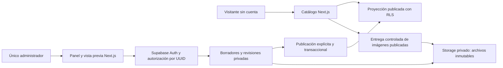

# Arquitectura propuesta

Arquitectura de referencia de etapa 0. La base de seguridad y separación de esquemas se implementó en etapa 3; ver [implementación y límites actuales](09-supabase-y-acceso.md). Las operaciones editoriales descritas siguen pendientes. Stack: Next.js con App Router y TypeScript; Supabase Auth, Postgres y Storage; Vercel sujeto a plan apto para uso comercial.

## Límites de acceso



1. **Catálogo:** lectura sin sesión Auth. Cliente Supabase de lectura con clave publicable y privilegios `anon`, aun desde servidor. Solo consulta la proyección publicada. No usar una clave privilegiada para resolver listados públicos.
2. **Panel:** rutas `/admin`, acciones y API requieren sesión validada en servidor y pertenencia al administrador único en base. Supabase SSR mediante cookies; RLS comprueba cada operación. Sin registro ni gestión de usuarios.
3. **Vista previa editorial:** requiere la misma sesión y autorización del panel; reutiliza los componentes públicos con un modelo de datos explícito de borrador. No es un enlace público compartible ni equivale a un deployment Preview de Vercel.
4. **Base:** esquemas `app` (edición e historial), `catalog` (solo proyección publicada) y `private` (autorización y funciones internas). Exponer únicamente los esquemas necesarios en Data API, con GRANT y RLS explícitos. `private` no se expone.
5. **Medios:** buckets privados del proyecto de concesionaria; entrega pública controlada solo de activos actualmente publicados; panel con JWT y RLS para medios privados. Detalles en [seguridad](04-seguridad.md).

Los nombres de esquemas/tablas son orientativos hasta las migraciones. Separar datos privados y publicados impide filtrar accidentalmente un borrador al añadir campos a una consulta.

## Mutaciones y publicación

- Acciones de servidor validan identidad, autorización, entrada, origen/CSRF y versión esperada. La base repite las invariantes, sin confiar en el formulario.
- Mutaciones editoriales mediante operaciones de base acotadas: guardado, publicación, retiro, papelera y restauración. No dar DML directo que permita omitir historial o modificar proyecciones.
- Publicar valida una revisión completa, genera las filas públicas permitidas, cambia el puntero publicado y agrega el evento en una única transacción. Una publicación de sitio puede incluir configuración y vehículos seleccionados como una sola entrega cuando necesite coherencia entre destacados y fichas.
- Archivar, retirar o enviar a papelera elimina la visibilidad pública y registra el evento atómicamente. No borra revisiones ni objetos de Storage.
- No hay transacción distribuida con Storage: primero subir/verificar el archivo privado; solo después referenciarlo en revisiones y publicar. Si falla una subida o publicación no debe quedar exposición parcial.
- Control de concurrencia optimista por versión esperada y bloqueo durante la transacción: dos pestañas del mismo administrador no se sobrescriben silenciosamente.

## Caché y revocación

Se propone comenzar con lectura dinámica del catálogo, sin caché pública persistente en HTML/API, para que el estado publicado sea inequívoco. Panel, vista previa y respuestas con sesión siempre sin caché compartida, con `Cache-Control: private, no-store` y exclusión de indexación.

La entrega controlada de imágenes comprobará la referencia publicada en cada nueva petición y no hará redirecciones a enlaces duraderos. No utilizar optimización/caché de imágenes privada que pueda servir un borrador después de cerrar sesión. Optimizar derivadas al subirlas; evaluar caché pública e invalidación cuando exista una política de retiro probada.

Los bytes públicos ya descargados no se pueden recuperar del dispositivo del visitante. La política de acceso controla nuevas solicitudes; no promete borrar copias externas.

## Organización futura del código

```text
src/app/(public)/       catálogo, ficha y estado vacío
src/app/admin/          sesión, edición, historial y papelera
src/app/api/media/      entrega controlada por referencia publicada
src/components/        UI accesible y bloques permitidos
src/features/          vehicles, site, editorial, media
src/lib/supabase/      clientes separados: lectura pública y sesión
src/lib/auth/          validación central de administrador
supabase/migrations/   esquema, permisos y funciones versionados
tests/                 permisos, publicación, restauración y flujos
docs/                  decisiones y operación
```

No se crean esas carpetas vacías ni servicios en esta etapa. Usar componentes de servidor por defecto e interacción cliente solo donde ayude. Evitar agregar ORM o servicios externos sin necesidad concreta.

## Entornos y secretos

- Desarrollo local aislado; futuros recursos Supabase y Vercel exclusivos de concesionaria. Nada enlazado a Documa.
- Un eventual deployment Preview no usará credenciales de escritura de producción. Su base y Auth deben estar aislados; no crear ramas/proyectos adicionales si su costo no está autorizado.
- Variables públicas futuras: URL y clave publicable de Supabase; identificadores no equivalen a autorización. Valores privados y configuración operativa solo en entornos seguros.
- Claves secretas de Supabase omiten RLS: reservarlas para bootstrap/mantenimiento acotado o la entrega de medios que lo necesite, siempre en servidor y con verificación previa. No usarlas como cliente general del panel.
- Backups de base y archivos deben diseñarse juntos. Historial editorial no reemplaza copias de seguridad ni recuperación ante pérdida del proyecto.
