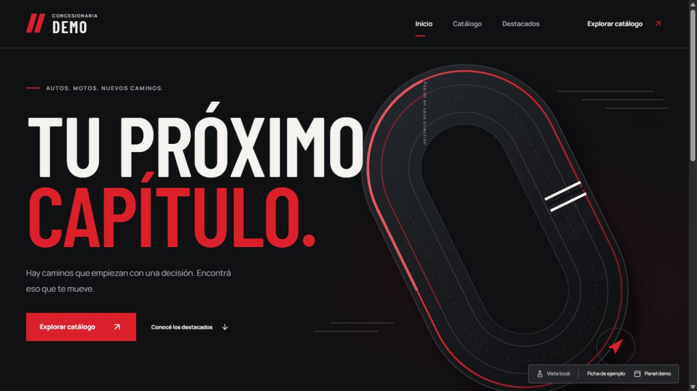
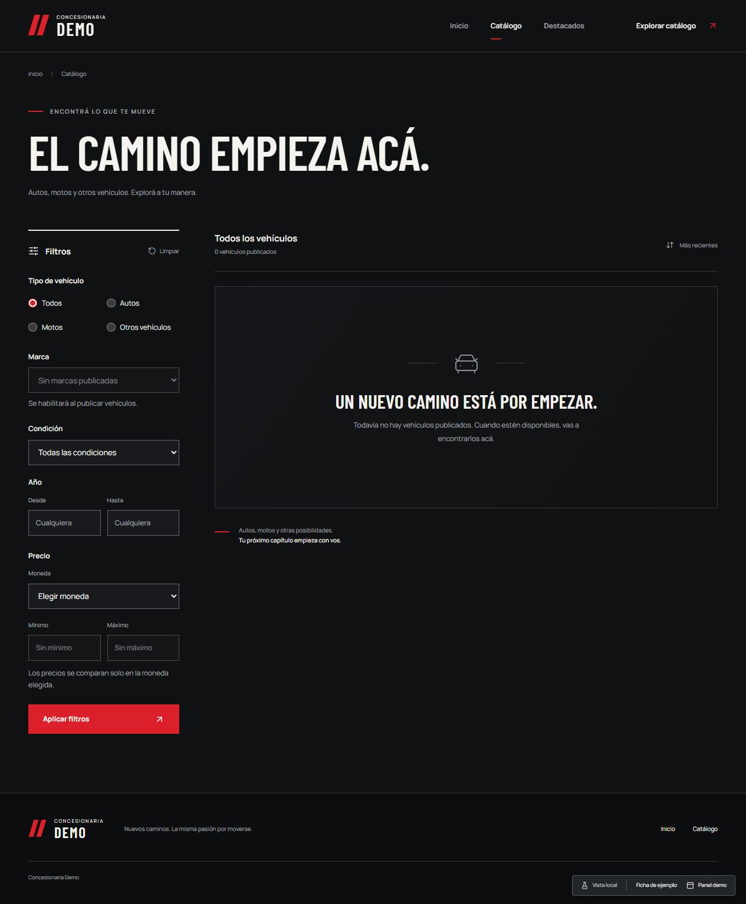
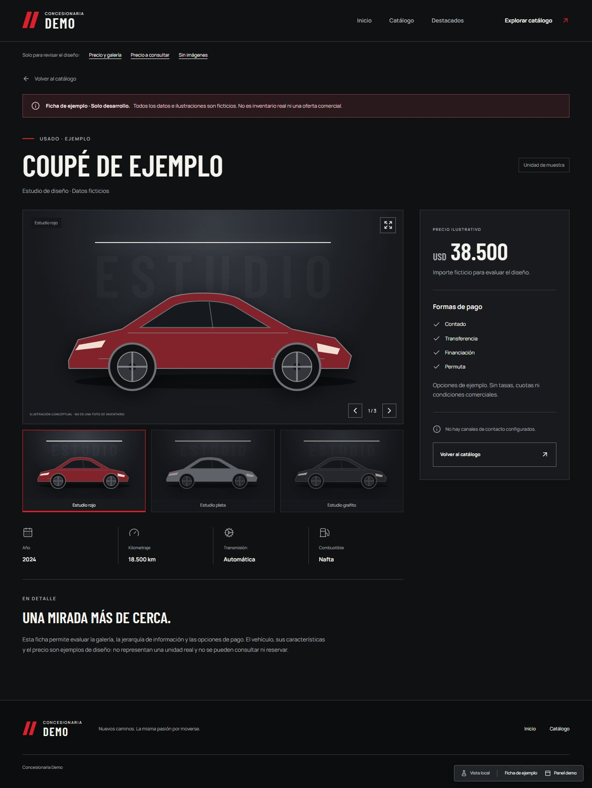
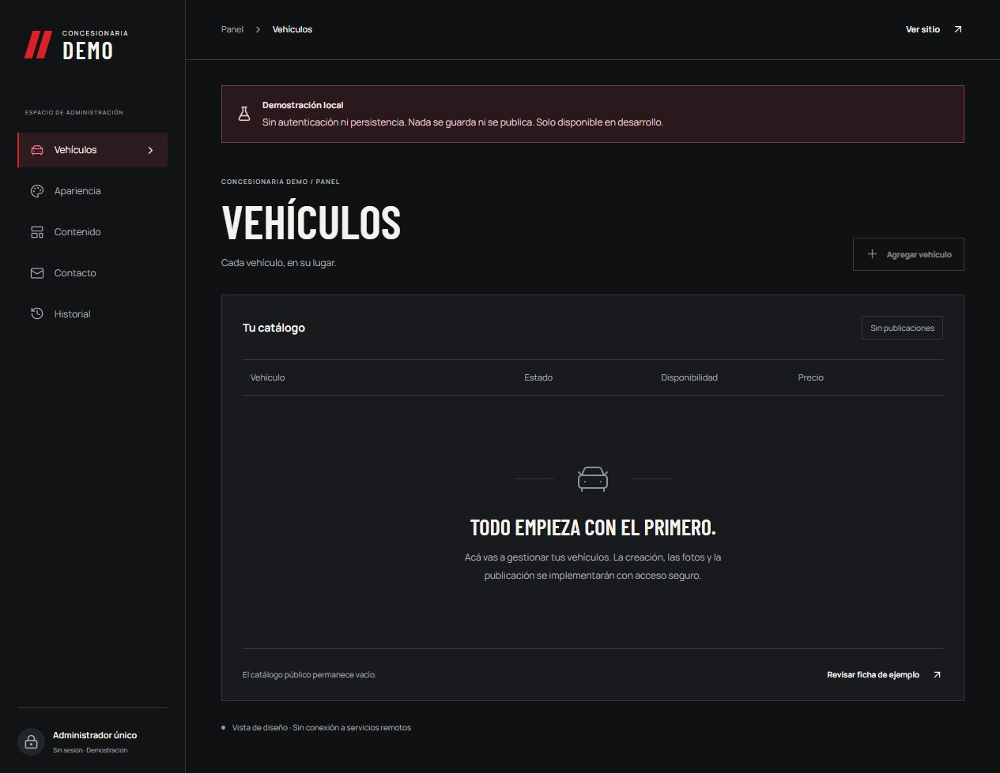
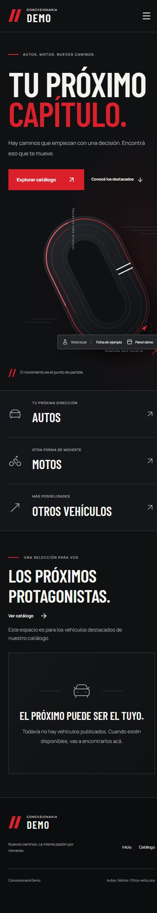

# Capturas de la etapa 2

Capturas reales del navegador local, 2 de noviembre de 2026. Ficha y panel son demos exclusivas de desarrollo; sin inventario real, autenticación ni persistencia.

Ventana de escritorio: 1280 px, contenido 1265 px. Ventana móvil: 390 px, contenido 375 px. Las capturas completas incluyen el largo de cada página.

| Pantalla        | Escritorio                                                                               | Móvil                                       |
| --------------- | ---------------------------------------------------------------------------------------- | ------------------------------------------- |
| Inicio          | [Página completa](etapa-2/inicio-escritorio.jpg) · [Portada](etapa-2/inicio-portada.jpg) | [Página completa](etapa-2/inicio-movil.jpg) |
| Catálogo        | [Captura](etapa-2/catalogo-escritorio.jpg)                                               | [Captura](etapa-2/catalogo-movil.jpg)       |
| Ficha ficticia  | [Captura](etapa-2/ficha-escritorio.jpg)                                                  | [Captura](etapa-2/ficha-movil.jpg)          |
| Panel demo      | [Captura](etapa-2/panel-escritorio.jpg)                                                  | [Captura](etapa-2/panel-movil.jpg)          |
| Apariencia demo | [Captura](etapa-2/apariencia-escritorio.jpg)                                             | Revisada en panel adaptable                 |

## Inicio

## Catálogo

## Ficha de ejemplo

## Panel

## Móvil

